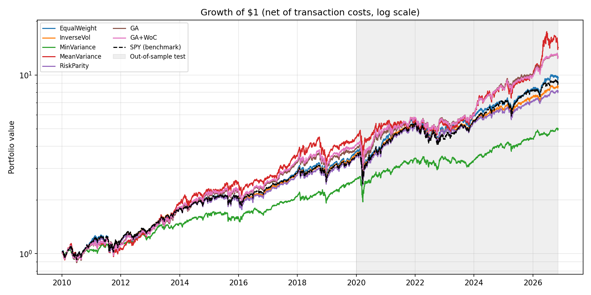
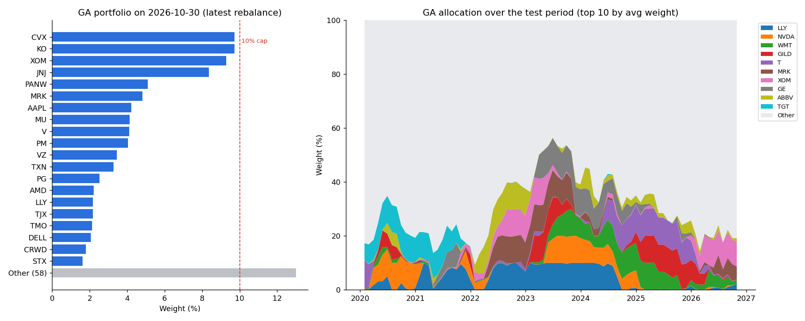
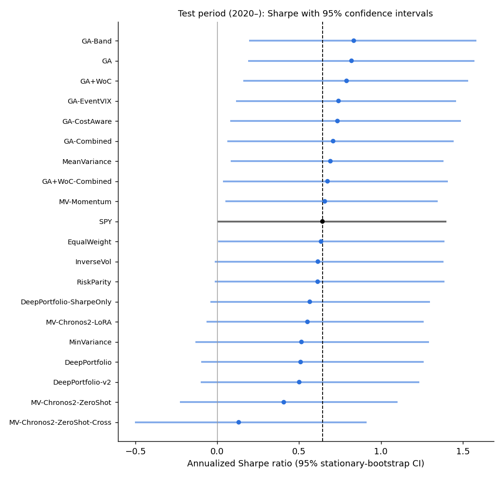

# Classic vs AI Portfolios on the S&P 500

**Do modern AI portfolio models actually beat classic methods once you add realistic
transaction costs and test them fairly?**

This project is a reproducible, walk-forward benchmark that puts classic portfolio
construction, evolutionary optimization, deep learning and time-series foundation models
through the **same honest backtester** on 16 years of S&P 500 data, including the 2020 COVID
crash and the 2022 bear market, and then asks whether any winner is **better than luck**.

**Short answer:** after costs, a genetic algorithm had the best test Sharpe (0.82 vs 0.64 for
SPY), the deep learning and foundation-model portfolios did not beat the market, and with ~7
years of test data **no strategy's edge over SPY is statistically significant** once you
account for the 35 configurations tried. An interactive dashboard lets you explore every run.



## Results so far (phase 1: classic and evolutionary baselines)

Out-of-sample test period, **Jan 2020 → Nov 2026**, monthly rebalancing, 10 bps costs,
100 most liquid point-in-time S&P 500 members, nothing tuned on this period:

| Strategy | CAGR | Volatility | Sharpe | Max drawdown | Turnover / yr |
|---|---:|---:|---:|---:|---:|
| SPY (benchmark) | 14.7% | 20.0% | 0.64 | -33.7% | – |
| Equal weight | 15.1% | 21.1% | 0.63 | -34.6% | 51% |
| Inverse volatility | 13.7% | 19.2% | 0.61 | -33.7% | 49% |
| Minimum variance | 9.9% | 14.9% | 0.51 | -27.9% | 183% |
| Mean-variance (Markowitz) | 18.6% | 25.1% | 0.69 | -29.3% | 354% |
| Risk parity | 13.2% | 18.3% | 0.61 | -33.0% | 57% |
| Genetic algorithm | 18.9% | 20.1% | **0.82** | -30.5% | 274% |
| Genetic algorithm + Wisdom of Crowds | 18.1% | 20.0% | 0.79 | -30.5% | 284% |

What the numbers say so far:

* **Passive is hard to beat.** Equal weight, inverse volatility and risk parity end up
  close to SPY once costs are included.
* **Minimum variance did its job in crises**: it lost only 12.6% in the 2022 bear market
  vs 24.1% for SPY, but it lagged badly in the 2023–2026 rally.
* **The genetic algorithm has the best Sharpe ratio**, but it trades ~2.7x its portfolio per year,
  and averaging the crowd (WoC) did not improve on the single best individual.
* These gaps turn out **not to be statistically significant** (phase 4 below): one historical
  path can easily make a lucky strategy look skilled.

Full tables for every period (development 2010–2019, COVID crash, 2022 bear market) are in
[`results/baselines/metrics.md`](results/baselines/metrics.md).

## Phase 2: end-to-end deep learning portfolio

A neural network outputs portfolio weights directly and is trained on the portfolio's
risk-adjusted return instead of on price forecasts. The universe changes every year, so the
model is **universe-agnostic and permutation-equivariant**:

```
60 days x 3 features per stock -> shared LSTM + temporal attention -> one embedding per stock
-> Transformer layer across stocks -> score per stock -> softmax -> long-only weights
loss = -Sharpe(next 21 days) + λ·CVaR(5%) + penalty above the 10% cap
```

It is retrained **every January on past data only** (chronological validation split with an
embargo gap, early stopping), and 5 seeds are averaged as a deep ensemble. One full walk-forward
run (2 variants × 18 yearly retrainings × 5 models) takes ~10 minutes on a GTX 1650.

| Test 2020 → Nov 2026 | CAGR | Volatility | Sharpe | Max drawdown | 2022 bear market |
|---|---:|---:|---:|---:|---:|
| SPY (benchmark) | 14.7% | 20.0% | 0.64 | -33.7% | -24.1% |
| Genetic algorithm | 18.9% | 20.1% | 0.82 | -30.5% | -12.3% |
| DeepPortfolio (Sharpe + CVaR) | 10.2% | 15.9% | 0.51 | -29.3% | -13.9% |
| DeepPortfolio (Sharpe only) | 11.7% | 17.0% | 0.57 | -30.4% | -15.8% |

**Honest result: the network did not beat the market.** It learned a diversified, defensive
portfolio (~55 stocks, max ~4% each, 0.88 correlation with equal weight): 20% less volatile than
SPY and much better in 2022, but it gave up too much upside in rallies. The CVaR term does reduce
tail risk, at a cost in return. This matches recent literature (Fernandes & Desell, 2026, report
a Sharpe of 0.29 on 2022–23): with price-only inputs there is little signal to learn, and early
stopping triggers after ~6 epochs. Full tables: [`results/deep/metrics.md`](results/deep/metrics.md).

### Phase 2b: can richer inputs fix it? A controlled tuning experiment

Three additions: a per-stock profile (12-1 month momentum, 1-month reversal, 1-year volatility
and beta, z-scored across stocks), the VIX index as a daily input, and a turnover penalty in the
loss. **Protocol:** 6 variants were run walk-forward on **2010–2019 only**, the selection rule
(highest development Sharpe) was fixed before running, and only the winner was then run
**once** on 2020+. All trials are kept in [`results/deep_tuning/`](results/deep_tuning/metrics.md).

| Trial (development 2010–2019) | Sharpe | Max drawdown | Turnover / yr |
|---|---:|---:|---:|
| T0: phase-2 model (reproduced exactly) | 0.88 | -23.2% | 165% |
| T1: + stock profile | 0.91 | -17.7% | 217% |
| **T2: + stock profile + VIX (selected)** | **0.93** | -17.5% | 209% |
| T3: T2 + turnover penalty 0.5 | 0.87 | -21.6% | 107% |
| T4: T2 + turnover penalty 2.0 | 0.86 | -22.4% | 56% |
| T5: T3 without CVaR | 0.82 | -27.8% | 81% |
| SPY | 0.90 | -19.3% | – |

| Out-of-sample test, 2020 → Nov 2026 | Development Sharpe | **Test Sharpe** | Test max drawdown |
|---|---:|---:|---:|
| DeepPortfolio (phase 2) | 0.88 | 0.51 | -29.3% |
| DeepPortfolio-v2 (T2) | 0.93 | **0.50** | -28.3% |
| SPY | 0.90 | 0.64 | -33.7% |

**The development gain did not survive out of sample.** A +0.05 Sharpe difference over ten
years is within noise, and picking the best of six variants rewards luck, which is exactly what
the locked test set is there to expose. The turnover penalty, however, works as intended: T4
cuts trading by two thirds for a small development cost, which is the most useful lever if
costs are higher than 10 bps. Full test tables: [`results/deep_v2/metrics.md`](results/deep_v2/metrics.md).

## Phase 3: do time-series foundation models help?

[Chronos-2](https://huggingface.co/amazon/chronos-2) (Amazon, 2025, 120M parameters) forecasts
each stock's price 21 trading days ahead from its last 512 days. The design is a clean
**predict-then-optimize ablation**: every strategy uses the same mean-variance optimizer,
covariance, cap, costs and mean shrinkage; **only the expected-return forecaster changes**.
Variants: zero-shot, zero-shot with cross-learning (stocks in a batch share information), and a
**LoRA adapter re-trained every January** on the universe's past prices (18 fine-tunes, ~2.5 min
each on a GTX 1650). Forecast skill is measured directly with the monthly **rank information
coefficient** (IC: rank correlation between forecast and realized next-month return).

| Forecaster → same optimizer | Mean IC dev (t-stat) | Mean IC test (t-stat) | Test Sharpe | Turnover / yr |
|---|---:|---:|---:|---:|
| Historical mean (= phase-1 Markowitz) | 0.027 (1.4) | 0.007 (0.2) | **0.69** | 354% |
| 12-1 momentum | 0.025 (1.2) | -0.004 (-0.1) | 0.66 | 382% |
| Chronos-2 zero-shot | 0.008 (0.6) | **0.022** (1.1) | 0.41 | 817% |
| Chronos-2 zero-shot, cross-learning | -0.010 (-0.7) | -0.016 (-0.7) | 0.13 | 861% |
| Chronos-2 + yearly LoRA fine-tuning | **0.029 (2.4)** | 0.017 (0.8) | 0.55 | 871% |
| SPY (benchmark) | | | 0.64 | – |

What this shows:

* **Fine-tuning helps the foundation model.** The LoRA version has the most consistent ranking
  skill (IC t-stat 2.4 in development, the only one above 2) and beats zero-shot on Sharpe.
* **Cross-learning hurts**: letting stocks share information produces *negative* skill.
* **Better forecasts did not mean better portfolios.** Chronos forecasts are unstable from month
  to month (rank autocorrelation 0.26–0.43, vs 0.90 for the historical mean), so the optimizer
  turns over ~8–9x the portfolio per year. At 10 bps that costs ~1.7% a year and adds noise, which
  erases a small IC edge. Forecast smoothing or a turnover-aware optimizer would be the next step.
* **Caveat on look-ahead**: a model released in 2025 may have seen market data from the backtest
  period during pretraining, a risk shared by all foundation models (and LLMs).

Full tables, including both crises: [`results/foundation/metrics.md`](results/foundation/metrics.md).

## Phase 4: when to trade, and is any of it better than luck?

### 4a. Smarter rebalancing for the genetic algorithm

The GA re-optimizes every month and its fitness ignores trading costs, so it reshuffles ~2.7x its
portfolio a year. Three fixes were added to the backtester and tested with the same protocol as
phase 2b (grid on 2010–2019 only, selection rule fixed in advance, test run once):

* **Cost-aware fitness**: Sharpe − λ × turnover from current holdings (λ = 4 selected).
* **No-trade band**: re-optimize monthly, but skip the trade unless the new portfolio differs from
  holdings by at least 20%.
* **Event-driven**: rebalance quarterly, plus whenever the VIX crosses 30 (checked weekly) or
  holdings drift 10% away from target.

| GA variant | Dev Sharpe (2010–19) | **Test Sharpe** | Test turnover / yr | 2022 bear market |
|---|---:|---:|---:|---:|
| Monthly (phase 1) | 0.89 | 0.82 | 274% | -12.3% |
| No-trade band 20% | 0.93 | **0.83** | 247% | -11.6% |
| Quarterly + VIX events | 0.94 | 0.74 | 228% | -12.4% |
| Cost-aware fitness (λ = 4) | **1.06** | 0.73 | **32%** | -23.1% |
| Cost-aware + events | – | 0.71 | 32% | -26.6% |
| SPY | 0.90 | 0.64 | – | -24.1% |

* **Cost-aware fitness cuts trading by 88%** and was the clear winner in development, but in the
  test period it lost Sharpe: a portfolio that rarely changes adapted slowly when 2022 rotated
  away from growth stocks. Less trading is not free: it also means slower reaction. (λ = 4 was
  the largest value in the grid; per the pre-registered rule it was not extended.)
* **The no-trade band is a small free win**: same Sharpe, 10% less trading.
* The drift trigger never fired in 2010–2019 (holdings never drifted 10% within a quarter); the
  VIX trigger fired 10 times (5 crossings up, 5 down). Every decision is logged
  (`results/rebalancing/rebalances_*.csv`). Full tables:
  [`results/rebalancing/metrics.md`](results/rebalancing/metrics.md).

**Where did the GA's return come from?** The backtester now records each stock's contribution.
In 2020–2026, **NVDA and LLY alone produced 20% of the GA's gross return** and the top 5 stocks
38%: the GA's edge is concentrated in a few momentum winners it held at the 10% cap.



### 4b. Is it skill or luck?

For every strategy, the test-period Sharpe ratio gets a 95% confidence interval from a
**stationary block bootstrap**, a paired bootstrap test against SPY, and the **Deflated Sharpe
Ratio** (Bailey & López de Prado, 2014), which corrects for having tried 35 configurations in
this project: the best of 35 skill-less strategies would reach a Sharpe of ~0.35 by chance alone.



| Test 2020 → Nov 2026 | Sharpe [95% CI] | Sharpe − SPY [95% CI] | p-value | DSR |
|---|---|---|---:|---:|
| GA, no-trade band | 0.83 [0.20, 1.58] | +0.19 [−0.22, +0.59] | 0.34 | 89% |
| GA | 0.82 [0.19, 1.57] | +0.18 [−0.24, +0.59] | 0.39 | 89% |
| Mean-variance | 0.69 [0.08, 1.38] | +0.05 [−0.50, +0.54] | 0.89 | 81% |
| SPY | 0.64 [0.00, 1.40] | | | |
| Equal weight | 0.63 [0.01, 1.39] | −0.01 [−0.18, +0.15] | 0.91 | 77% |
| Chronos-2 + LoRA | 0.55 [−0.07, 1.26] | −0.09 [−0.47, +0.23] | 0.58 | 70% |
| DeepPortfolio | 0.51 [−0.10, 1.26] | −0.13 [−0.53, +0.25] | 0.50 | 66% |

* **No strategy beats SPY with statistical significance.** Every confidence interval for the
  difference with SPY contains zero, and no DSR reaches 95%. Seven years of daily data are
  simply too short to separate a 0.2 Sharpe edge from luck: the intervals are ±0.7 wide.
* The only significant difference is negative: Chronos-2 with cross-learning *underperformed*
  SPY (p = 0.04).
* All 20 strategies: [`results/analysis/README.md`](results/analysis/README.md).

### 4c. Crises

Every SPY drawdown deeper than 15% since 2010 (6 episodes, windows chosen by SPY alone):

| Peak → trough | SPY | Min variance | DeepPortfolio-v2 | GA | Equal weight |
|---|---:|---:|---:|---:|---:|
| Apr–Jul 2010 (flash crash, euro crisis) | -15.7% | -10.0% | -17.5% | -18.8% | -17.2% |
| Apr–Oct 2011 (US downgrade) | -18.6% | -5.1% | -17.3% | -15.5% | -23.4% |
| Sep–Dec 2018 | -19.3% | -13.9% | -12.8% | -22.7% | -20.2% |
| Feb–Mar 2020 (COVID) | -33.7% | -27.9% | -28.0% | -30.5% | -34.6% |
| Jan–Oct 2022 (bear market) | -24.5% | -12.7% | -13.3% | -12.4% | -25.0% |
| Feb–Apr 2025 (tariff shock) | -18.8% | -11.0% | -9.4% | -14.8% | -20.2% |
| **Average** | **-21.8%** | **-13.4%** | -16.4% | -19.1% | -23.4% |

Minimum variance is the most reliable crisis hedge (better than SPY in all six episodes), and the
defensive deep learning portfolio comes second: they lose in rallies what they save in crashes.

### Interactive dashboard

```bash
pip install -e ".[dashboard]"
streamlit run app/dashboard.py
```

Five tabs: performance for any period and set of strategies, the significance tests, a crisis
heatmap, a **portfolio explorer** (holdings at any rebalance date, allocation over time, which
stocks drove the return) and a **rebalancing timeline** showing every decision with its trigger
(schedule, drift, VIX) next to the VIX. It reads only the committed `results/` folder, so it
runs right after cloning, without downloading any market data.

## How the evaluation stays honest

* **Point-in-time universe**: stocks are chosen from the S&P 500 members *on that date*
  (historical membership), not from today's index. Renamed companies (e.g. FB → META) are mapped.
* **Walk-forward, no look-ahead**: each decision only sees the trailing year of data; trades
  execute at the close and earn returns from the next day. Unit tests enforce this.
* **Realistic frictions**: weights drift between rebalances, and every trade pays
  transaction costs, including the initial purchase.
* **Locked test set**: 2020 onward is never used for tuning any model.
* **Correct risk-free rate**: Sharpe and Sortino use excess returns over 1-month T-bills.
* **Every trial counts**: all tuning trials are kept, and the Deflated Sharpe Ratio penalizes
  the number of configurations tried.

Details and known limitations: [`docs/methodology.md`](docs/methodology.md).

## Quickstart

```bash
python -m venv .venv
.venv\Scripts\activate          # Windows  (Linux/macOS: source .venv/bin/activate)
pip install -e ".[dev]"
# optional, for the deep learning and foundation models (GPU build: see pytorch.org)
pip install torch --index-url https://download.pytorch.org/whl/cu126
pip install -e ".[foundation]"

pfopt download --config configs/baselines.yaml   # ~3 min, free public data
pfopt backtest --config configs/baselines.yaml   # ~3 min on a laptop CPU
pfopt backtest --config configs/deep.yaml        # ~10 min on a GTX 1650
pfopt backtest --config configs/foundation.yaml  # ~55 min on a GTX 1650 (LoRA fine-tuning)
pfopt backtest --config configs/rebalancing.yaml # ~7 min, GA rebalancing variants
pfopt analyze                                    # significance + crisis tables, all experiments
streamlit run app/dashboard.py                   # needs pip install -e ".[dashboard]"
pytest                                           # 55 tests, synthetic data, no network
```

Results (tables, figures, weights) are written to `results/<experiment>/`. A new strategy is
a class with one method, `allocate(history) -> weights`, plus one line in a YAML config.

## Project structure

```
configs/            experiment definitions (YAML)
src/pfopt/
  data/             downloaders, point-in-time universe, MarketData loader
  backtest/         walk-forward engine and performance metrics
  strategies/       classic optimizers, genetic algorithm, deep learning, forecast + optimize
  forecasters.py    historical mean, momentum, Chronos-2 (zero-shot / LoRA fine-tuned)
  analysis.py       forecast skill (rank information coefficient)
  stats.py          bootstrap Sharpe CIs, Probabilistic / Deflated Sharpe Ratio, drawdown episodes
  robustness.py     cross-experiment significance and crisis analysis
  reporting.py      metric tables and figures
  cli.py            `pfopt download` / `backtest` / `analyze`
app/                Streamlit dashboard
tests/              unit tests (engine timing, costs, metrics, constraints)
docs/               methodology and limitations
legacy/             the original course notebook this project grew from
```

## Roadmap

- [x] **Phase 1**: data pipeline, backtester, classic baselines, genetic algorithm + WoC
- [x] **Phase 2**: end-to-end deep learning portfolio (attention-LSTM + cross-asset Transformer
      trained directly on a Sharpe/CVaR objective, following Fernandes & Desell, 2026)
- [x] **Phase 2b**: richer inputs (momentum, reversal, volatility, beta, VIX) and a turnover-aware loss,
      tuned on 2010–2019 only, with every tried configuration logged
- [x] **Phase 3**: time-series foundation model (Chronos-2) forecasts → optimizer, zero-shot vs
      LoRA fine-tuned, with forecast skill measured by rank IC
- [x] **Phase 4**: event-driven and cost-aware rebalancing, return attribution, statistical
      significance (bootstrap Sharpe CIs, Deflated Sharpe Ratio), crisis analysis, Streamlit
      dashboard
- [ ] Next ideas: CRSP data (no survivorship bias), sector constraints, more test years

## Data sources

* Prices: Yahoo Finance via [`yfinance`](https://github.com/ranaroussi/yfinance)
* Historical S&P 500 membership: [fja05680/sp500](https://github.com/fja05680/sp500) (MIT)
* Risk-free rate: [Kenneth R. French Data Library](https://mba.tuck.dartmouth.edu/pages/faculty/ken.french/data_library.html)

*Research and education project, not investment advice.*
