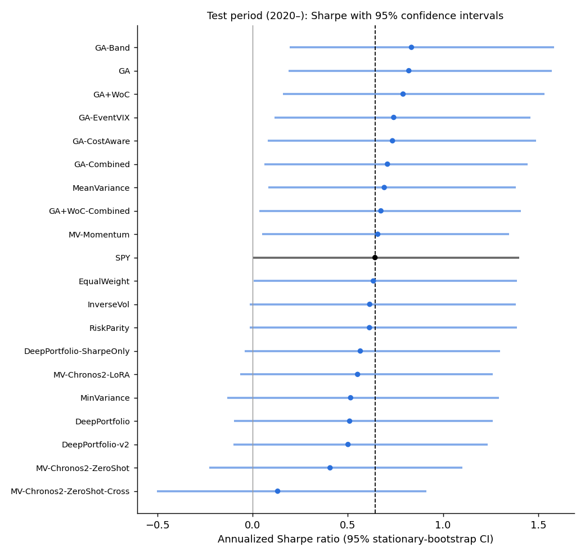

# Phase 4: is any of this better than luck?

Test period: 2020-01-01 onward (1724 trading days). Sharpe ratios are on excess returns over the risk-free rate, annualized. Confidence intervals come from a stationary block bootstrap (5,000 resamples, mean block 21 days); the difference with SPY uses the same resampled days for both (paired test).

**Deflated Sharpe Ratio.** 35 strategy configurations were tried in this project (including tuning trials that never saw the test period). With that many tries, the best skill-less strategy would be expected to reach an annualized Sharpe of about **0.35** by luck alone. DSR is the probability that a strategy's true Sharpe beats that bar; PSR is the probability that it beats 0. A DSR above 95% would be convincing evidence of skill.

Identical return series counted once: MV-HistoricalMean = MeanVariance, E-drift0.20-vix30 = E-drift0.10-vix30.

| Strategy | Experiment | Sharpe | 95% CI | Sharpe − SPY | 95% CI | p-value | PSR | DSR |
|---|---|---:|---|---:|---|---:|---:|---:|
| GA-Band | rebalancing | 0.83 | [0.19, 1.58] | +0.19 | [-0.22, +0.59] | 0.34 | 98% | 89% |
| GA | baselines | 0.82 | [0.19, 1.57] | +0.18 | [-0.24, +0.59] | 0.39 | 98% | 89% |
| GA+WoC | baselines | 0.79 | [0.16, 1.53] | +0.15 | [-0.27, +0.57] | 0.47 | 98% | 87% |
| GA-EventVIX | rebalancing | 0.74 | [0.11, 1.46] | +0.10 | [-0.36, +0.52] | 0.66 | 97% | 84% |
| GA-CostAware | rebalancing | 0.73 | [0.08, 1.49] | +0.09 | [-0.22, +0.38] | 0.54 | 97% | 84% |
| GA-Combined | rebalancing | 0.71 | [0.06, 1.44] | +0.07 | [-0.23, +0.32] | 0.62 | 97% | 82% |
| MeanVariance | baselines | 0.69 | [0.08, 1.38] | +0.05 | [-0.50, +0.54] | 0.89 | 96% | 81% |
| GA+WoC-Combined | rebalancing | 0.67 | [0.04, 1.41] | +0.03 | [-0.28, +0.30] | 0.83 | 96% | 80% |
| MV-Momentum | foundation | 0.66 | [0.05, 1.35] | +0.01 | [-0.52, +0.50] | 1.00 | 96% | 79% |
| SPY | benchmark | 0.64 | [0.00, 1.40] | – | – | – | – | – |
| EqualWeight | baselines | 0.63 | [0.01, 1.39] | -0.01 | [-0.18, +0.15] | 0.91 | 95% | 77% |
| InverseVol | baselines | 0.61 | [-0.01, 1.38] | -0.03 | [-0.21, +0.16] | 0.78 | 94% | 75% |
| RiskParity | baselines | 0.61 | [-0.01, 1.39] | -0.03 | [-0.25, +0.20] | 0.83 | 94% | 75% |
| DeepPortfolio-SharpeOnly | deep | 0.57 | [-0.04, 1.30] | -0.08 | [-0.38, +0.21] | 0.61 | 93% | 71% |
| MV-Chronos2-LoRA | foundation | 0.55 | [-0.07, 1.26] | -0.09 | [-0.47, +0.23] | 0.58 | 92% | 70% |
| MinVariance | baselines | 0.51 | [-0.13, 1.29] | -0.13 | [-0.62, +0.34] | 0.59 | 91% | 66% |
| DeepPortfolio | deep | 0.51 | [-0.10, 1.26] | -0.13 | [-0.53, +0.25] | 0.50 | 91% | 66% |
| DeepPortfolio-v2 | deep_v2 | 0.50 | [-0.10, 1.23] | -0.14 | [-0.59, +0.29] | 0.53 | 90% | 65% |
| MV-Chronos2-ZeroShot | foundation | 0.41 | [-0.23, 1.10] | -0.24 | [-0.65, +0.11] | 0.17 | 85% | 56% |
| MV-Chronos2-ZeroShot-Cross | foundation | 0.13 | [-0.50, 0.91] | -0.51 | [-0.96, -0.02] | 0.04 | 63% | 28% |

## Crisis behavior

Every SPY drawdown deeper than 15% since 2010-01-01 (6 episodes; windows chosen by SPY alone, peak to trough). Cells are each strategy's total return over the same days.

| Strategy | 2010-04-23 → 2010-07-02 | 2011-04-29 → 2011-10-03 | 2018-09-20 → 2018-12-24 | 2020-02-19 → 2020-03-23 | 2022-01-03 → 2022-10-12 | 2025-02-19 → 2025-04-08 | Average |
|---|---:|---:|---:|---:|---:|---:|---:|
| MinVariance | -10.0% | -5.1% | -13.9% | -27.9% | -12.7% | -11.0% | -13.4% |
| DeepPortfolio-v2 | -17.5% | -17.3% | -12.8% | -28.0% | -13.3% | -9.4% | -16.4% |
| DeepPortfolio | -16.3% | -23.2% | -14.0% | -29.3% | -13.7% | -12.5% | -18.2% |
| GA-EventVIX | -18.2% | -16.8% | -23.5% | -29.8% | -12.1% | -12.3% | -18.8% |
| GA-Band | -18.1% | -14.6% | -23.8% | -30.6% | -11.6% | -15.0% | -19.0% |
| GA | -18.8% | -15.5% | -22.7% | -30.5% | -12.4% | -14.8% | -19.1% |
| DeepPortfolio-SharpeOnly | -17.3% | -24.1% | -14.9% | -30.3% | -16.0% | -13.4% | -19.3% |
| GA+WoC | -17.7% | -16.9% | -23.1% | -30.5% | -13.3% | -14.9% | -19.4% |
| RiskParity | -14.9% | -19.3% | -19.0% | -33.0% | -19.8% | -15.2% | -20.2% |
| MV-Chronos2-ZeroShot-Cross | -10.3% | -18.1% | -17.3% | -50.9% | -12.5% | -17.7% | -21.1% |
| InverseVol | -15.4% | -19.9% | -18.9% | -33.7% | -22.1% | -16.9% | -21.2% |
| MV-Chronos2-ZeroShot | -16.2% | -17.3% | -22.0% | -33.1% | -23.7% | -15.8% | -21.3% |
| GA-CostAware | -18.8% | -17.1% | -21.0% | -30.9% | -23.8% | -17.7% | -21.6% |
| MeanVariance | -21.4% | -17.3% | -28.6% | -29.2% | -12.7% | -21.4% | -21.8% |
| SPY | -15.7% | -18.6% | -19.3% | -33.7% | -24.5% | -18.8% | -21.8% |
| MV-Momentum | -20.0% | -17.6% | -28.7% | -28.9% | -14.9% | -21.5% | -21.9% |
| MV-Chronos2-LoRA | -16.2% | -13.1% | -26.0% | -31.3% | -26.7% | -20.4% | -22.3% |
| GA+WoC-Combined | -19.4% | -18.2% | -22.2% | -31.9% | -28.7% | -16.6% | -22.8% |
| GA-Combined | -19.7% | -16.9% | -23.9% | -31.5% | -27.6% | -17.8% | -22.9% |
| EqualWeight | -17.2% | -23.4% | -20.2% | -34.6% | -25.0% | -20.2% | -23.4% |
